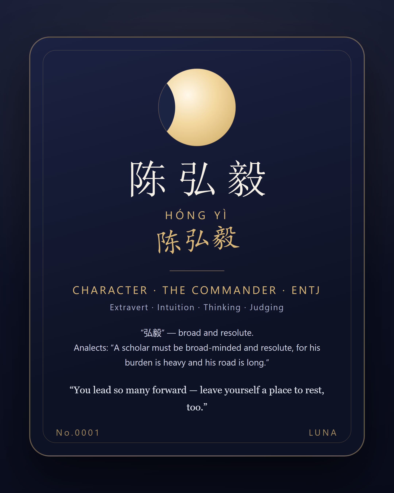

# Luna's Naming · 月相酿名

> A 16-personality test that brews you a Chinese name — with a **real, cited source**.
> 一个十六型人格测试，按你的性格为你「酿」一个中文名，每个名字都带**真实典籍出处**。



---

## ✨ What it is

```
32 questions  →  your personality (16 types)
              →  your moon phase (8 phases × 2)
              →  a Chinese name that fits you
              →  a shareable "moon card"
```

- **32 questions**, 4 dimensions (E/I · S/N · T/F · J/P) × 8 each
- **16 types**, each mapped to one of **8 moon phases**
- **Chinese name generator** — names come from the *Book of Songs*, *Songs of Chu*, and Tang–Song poetry
- **Moon card** — name, pinyin, signature, personality, source, and a line from Luna

---

## 🚀 Run it

No build step. No dependencies. No server.

```bash
# just open it
open index.html
```

Or serve it locally:

```bash
python -m http.server 8000
# → http://localhost:8000
```

Files:

| File | Language |
|---|---|
| `index.html` | English |
| `zh.html` | 繁體中文 (Traditional Chinese) |
| `zh-Hans.html` | 简体中文 (Simplified Chinese) |
| `ja.html` | 日本語 (Japanese) |
| `sample-card.html` | Moon card template (preview / high-res export) |

> 📦 **Archived — the v1 site is still live.** The previous site (a first-name → Chinese-name
> generator with ~500 SEO landing pages) is preserved under [`v1/`](v1/) and browsable as-is.
> See [CHANGELOG.md](CHANGELOG.md) for the full version history.

---

## 🧩 How it works

1. **Personality** — a lightweight 4-dimension questionnaire (same structure as MBTI, but with our own wording).
2. **Moon phase** — 16 types × 2 (J/P) = 8 moon phases. The moon is a **visual metaphor**, not a prediction.
3. **Naming** — rules-based: each of the four groups (NT / NF / SJ / SP) has its own character pool, hand-picked with **verifiable classical sources**.
4. **Moon card** — everything assembled into one shareable card.

---

## 📖 The name bank

**80 names** — 20 in each of the four groups (NT / NF / SJ / SP). Every name carries its original line and its source. Examples:

| Name | Meaning | Source |
|---|---|---|
| 修远 xiū yuǎn | a long road, endless seeking | 《楚辞·离骚》"路漫漫其修远兮" |
| 子衿 zǐ jīn | the scholar's collar, refined | 《诗经·郑风·子衿》"青青子衿" |
| 恒 héng | lasting, constant | 《诗经·小雅·天保》"如月之恒" |
| 长风 cháng fēng | the long wind, sailing far | 唐·李白《行路难》"长风破浪会有时" |

> ⚠️ **We never invent sources.** If a name can't be traced to a real text, it doesn't go in.

---

## 🔒 Privacy

Everything runs **in your browser**. No data is collected, sent, or stored.

---

## ⚠️ Disclaimer

This is a **playful reference for self-reflection and emotional companionship**.
It is **not** medical, psychological, or professional advice.
It does **not** predict your future or your fortune.

---

## 🗺 Roadmap

- [x] Moon card export — in-app PNG + `sample-card-A4.pdf` (printable)
- [x] Four languages — English / 繁體中文 / 简体中文 / 日本語
- [x] 80-name bank — 20 per group, every one with a verifiable source
- [ ] Server-side card rendering (auto-delivered by email)
- [ ] Optional translations of the source lines

---

## 📄 License

[MIT](LICENSE) © 2026 Slow Glow

---

## 中文简介

**月相酿名**是一个纯前端的十六型人格测试 + 中文起名工具：

- 32 道题测出你的人格（16 型），并映射到一个**月相**
- 根据你的性格，从**诗经 / 楚辞 / 唐诗宋词**的真实出处里酿一个中文名
- 最后生成一张**月相卡**（姓名 / 拼音 / 签名 / 性格 / 出处 / 寄语）

**不预测、不算命**——月相只是一个温柔的比喻。
所有名字的真实出处都可核对，**绝不编造**。

单文件、零依赖、离线可用。MIT 协议，欢迎使用与修改。